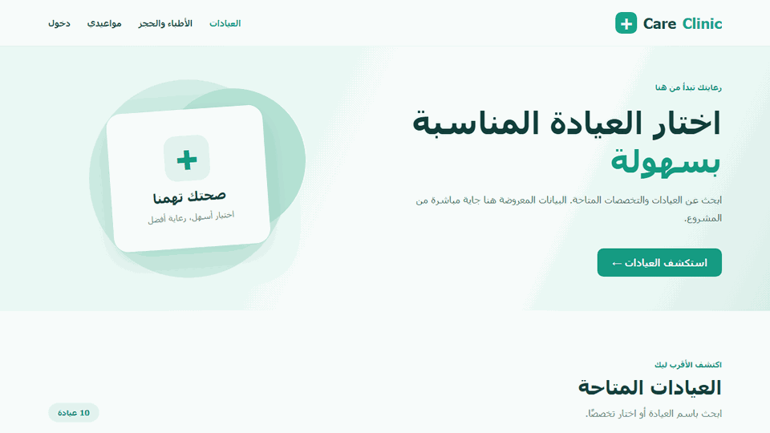

# CareClinic

**Find a clinic, choose a doctor, and book an appointment in one place.**

## What is CareClinic?

CareClinic brings the main steps of booking a clinic visit into one app. Patients can discover clinics, compare doctors, check available times, and reserve an appointment through the same interface. The preview above shows the Arabic interface built for this project.

The React frontend communicates with a Node.js and Express API. MongoDB stores clinics, doctors, available slots, accounts, and appointments. The API checks each booking before saving it, so a slot that has already been reserved cannot be taken by another patient.

## Features

- **Find a clinic:** Browse the clinic list, search by name, or filter by specialty. Each clinic has a details view with its address, working hours, consultation price range, and doctor count.
- **Explore doctors:** Filter doctors by specialty, see which clinic they work at and their consultation fee, then open their available appointments for a selected day.
- **Create an account:** Register with an email address, verify it using a six-digit code, and sign in. A new code can be requested if the first one expires.
- **Book a visit:** Choose a free time slot and enter the patient's name, mobile number, and date of birth. The backend validates the details and prevents duplicate bookings of the same slot.
- **Confirm a demo deposit:** A new booking waits for payment confirmation for a limited time. The demo payment step confirms it; an unpaid booking expires and its slot becomes available again.
- **Manage bookings:** The My Appointments page shows a patient's bookings and lets them cancel a confirmed appointment. The recorded deposit outcome depends on how close the cancellation is to the appointment time.
- **Receive email:** Verification codes and booking confirmations can be sent by email when the project's sending account is configured.

## The patient journey

1. Find a suitable clinic and doctor, then pick a day with an available time.
2. Register or sign in, and provide the patient's details to reserve the slot.
3. Confirm the simulated deposit before the booking expires.
4. Follow the appointment in My Appointments, or cancel it if plans change.

> Payments and refunds are simulated in the database. The project does not charge or return real money.
